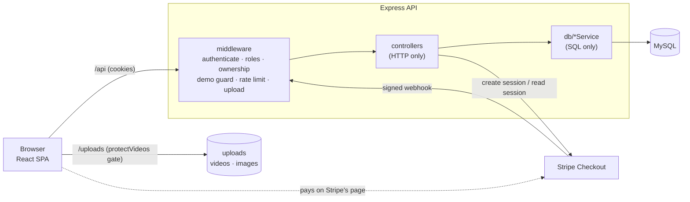

# Lumen

[](https://github.com/DidierDankan/course-platform/actions/workflows/ci.yml)

A two-sided video-course marketplace. Instructors publish video courses; students buy them one at a time through Stripe Checkout and watch them with saved progress, reviews and a discussion under each video. There is also an admin role.

This is a portfolio project. The aim is production habits rather than feature count. Paid videos are gated on the server. Payments are recorded idempotently from two paths. Refresh tokens rotate and detect reuse. Every write that touches several tables runs in one transaction. A test suite runs against a real MySQL database in three SQL modes on every push.

---

## Tech stack

| Layer | Technology |
|---|---|
| Frontend | React 19, Vite 7, React Router 7, Redux Toolkit + RTK Query, Formik + Yup, Tailwind CSS v4, Headless UI, lucide-react, Embla carousel |
| Backend | Node.js (ES modules), Express 5, mysql2 (raw parameterized SQL, no ORM), express-validator, Multer, Helmet, express-rate-limit |
| Auth | JWT access token (jsonwebtoken, 15 min, HttpOnly cookie) + rotating opaque refresh token (stored as a SHA-256 hash); bcryptjs for passwords |
| Database | MySQL 8.4 (InnoDB, utf8mb4); schema in numbered SQL migrations |
| Payments | Stripe Checkout (one-time payments, USD, test mode) + a signed webhook |
| Tests | Vitest + Supertest against a real MySQL test database; autocannon for a local load test |
| CI | GitHub Actions: client lint + build; server tests in three SQL modes on `mysql:8.4`, plus a boot check. Required checks on `main` |

Planned deployment: Vercel (client), Render (API), Aiven (MySQL), Supabase Storage (media).

---

## Architecture



- **Layers:** a route wires up middleware, a controller handles HTTP, and a service holds the SQL. Controllers contain no SQL, and services never see `req` or `res`.
- **Authorization runs on the server.** Every route that reads or changes a course, lesson or enrollment checks ownership in middleware (`middleware/courseOwnership.js`). The client's route guards only shape the interface.
- **Client:** one RTK Query slice per domain (`client/src/api/modules`). A base query catches a 401, refreshes the session once (behind a mutex, so parallel requests share one refresh) and retries. Every page except Home loads lazily.

---

## Features

- **Roles:** students (`user`), instructors (`seller`) and `admin`.
- **Courses:** instructors create, edit and delete courses with a thumbnail and ordered video lessons; any lesson can be a free preview. Saves are all-or-nothing.
- **Browse:** infinite scroll, with filters and sort kept in the URL (shareable, and they survive a reload). The home page has a carousel of the most popular courses.
- **Buying:** Stripe Checkout. The purchase is recorded by the webhook *or* by the buyer's return to the site, whichever comes first, so a late webhook never leaves a paying student without access.
- **Watching:** progress is saved per lesson and "Continue" resumes where you left off. Paid videos are only served to the owner, an admin, an enrolled student, or for preview lessons.
- **Reviews:** one rating per enrolled student per course (never the instructor's own). "Top rated" uses a damped average, so a single 5-star review doesn't outrank hundreds at 4.8.
- **Comments and notifications:** a discussion under each video. Instructors get a notification for each new review and comment, written in the same transaction; the header bell polls while the tab is visible.
- **Instructor dashboard:** students and revenue over the last 12 months and the top courses, drawn as hand-built, accessible SVG charts (keyboard focus and a data table for screen readers).
- **Two themes:** `brutal` (neo-brutalist) and `cinematic` (dark). One set of design tokens; the theme only switches the values.
- **Public demo:** demo accounts with a published password. The server blocks the writes that would break the demo for the next visitor, and puts the demo back once a day.

---

## Decisions and trade-offs

| Decision | Why | Trade-off |
|---|---|---|
| **Short JWT access token + rotating opaque refresh token** | The access token is checked without a database lookup. The refresh token is random, stored only as a hash, works once, and a replayed old token revokes the whole login. Logout is a real revocation. | One database write per refresh (every 15 minutes per active user). |
| **Tokens in HttpOnly cookies, refresh cookie scoped to `/api/auth`** | Page JavaScript can't read them (XSS can't steal them); the refresh token isn't sent with every request. | Needs same-site deployment (the Vercel rewrites put client and API on one origin). |
| **Raw SQL with mysql2, no ORM** | Every query is visible and reviewable; transactions and row locks (`FOR UPDATE`) are explicit. | More code than an ORM; queries are hand-written. |
| **Payment recorded by both the webhook and the buyer's return** | Render's free tier sleeps, so a webhook can arrive late. Both paths share one idempotent transaction (`INSERT … ON DUPLICATE KEY`). | Two code paths into one function; covered by tests that run them at the same moment. |
| **Tests against real MySQL, no mocks** | The bugs found were MySQL behaviour (strict mode, unique keys, foreign keys, gap-lock deadlocks) that a mock can't reproduce. | Tests need a MySQL server; CI runs one as a service container. |
| **Polling instead of WebSockets for notifications** | A badge that updates within a minute is enough; no extra infrastructure on a free host. | Up to 60 s delay. |
| **Rate limits in memory** | One server instance; no Redis to run. | Counters reset on restart and aren't shared between instances. |
| **Stripe one-time payments only** | Subscriptions bring proration, dunning and `past_due` states, which is a project of its own. | No subscription model. |

---

## Security

- **Passwords:** bcrypt; passwords over 72 bytes are refused at registration (bcrypt ignores the rest).
- **Auth answers:** missing, invalid or expired token → 401; signed in but not allowed → 403. The JWT algorithm is pinned and the token has a `type` claim.
- **Brute force:** login and registration are rate limited per IP (429).
- **Input:** every route validates its input before any SQL. All SQL is parameterized, and objects are never expanded into SQL.
- **Uploads:** a MIME whitelist decides the file extension on the server; 200 MB cap; `nosniff`.
- **Paid videos:** served only after the `protectVideos` check, with `Cache-Control: private, no-store`.
- **Headers and origins:** Helmet sets security headers on every response; CORS allows only the client's origin.
- **Payments:** the Stripe webhook signature is verified; a purchase is only recorded when Stripe says it's paid.
- **Errors and logs:** clients get short JSON errors, never a stack trace; logs never include the SQL values (which can hold user data).
- **Public answers:** never include a seller's email or a password hash.

---

## Tests

```bash
cd server
npm test                                    # Vitest + Supertest, real MySQL
TEST_SQL_MODE="ANSI,TRADITIONAL" npm test   # also: NO_ENGINE_SUBSTITUTION (loose)
```

`npm test` drops and rebuilds a database called `lumen_test` with the real migrations, then calls the API through Supertest (no port, no mocks). It refuses any database whose name doesn't end in `_test`, and any upload folder outside the OS temp folder.

What the suite covers:

- **Authorization:** another seller's course or lessons, a paid video without an enrollment, a free enrollment on a paid course. Each refusal sits next to a control request that succeeds.
- **Payments:** checkout → webhook → enrollment, the buyer's return confirming the purchase, and both arriving at the same moment.
- **Tokens:** rotation, reuse detection, the grace window for parallel tabs, logout revocation, role changes taking effect at the next refresh.
- **Validation:** bad input answers 4xx, never 500, under MySQL's strict mode.
- **Concurrency:** parallel webhooks give one enrollment, parallel favorites one row, parallel profile saves never deadlock.
- **Leaks:** no seller email, password hash or paid file URL where it shouldn't be; no stack trace to clients; no SQL values in logs.
- **Demo:** runs the real `seed:demo`, then checks what demo accounts can and can't do, and the daily reset including its lock.

CI runs the whole suite in MySQL's strict, loose and ANSI modes, so the app doesn't depend on one server's settings. Known bugs are kept as expected failures (`it.fails`): the suite stays green and turns red the moment one is fixed, so the marker is removed with the fix.

---

## Running it locally

Requires Node.js 22+ and MySQL 8.

```bash
git clone https://github.com/DidierDankan/course-platform.git
cd course-platform
(cd server && npm install)
(cd client && npm install)
```

Create an empty database (for example `lumen_dev`); the migrations create the tables.

**`server/.env`**

```env
PORT=3001
DB_HOST=localhost
DB_PORT=3306
DB_USER=root
DB_PASS=
DB_NAME=lumen_dev
JWT_ACCESS_SECRET=          # a long random string
STRIPE_SECRET_KEY=          # sk_test_... from the Stripe dashboard
STRIPE_WEBHOOK_SECRET=      # whsec_... printed by `stripe listen`
CLIENT_URL=http://localhost:5173

# optional
DEMO_PASSWORD=              # needed by npm run seed:demo
DEMO_RESET_HOURS=           # e.g. 24: the server resets the demo that often
DB_SQL_MODE=                # pin MySQL's SQL mode
UPLOAD_DIR=                 # default: server/uploads
TRUST_PROXY_HOPS=           # behind a proxy (Render): the number of proxies in front
```

The server checks the required variables at start-up and stops with the name of any that's missing.

**`client/.env`**

```env
VITE_API_URL=http://localhost:3001
VITE_DEMO_PASSWORD=         # optional: shows the demo accounts on the login page (same value as DEMO_PASSWORD)
```

**Run**

```bash
cd server && npm run migrate && npm run dev     # API on :3001
cd client && npm run dev                        # app on :5173
stripe listen --forward-to http://localhost:3001/api/payments/webhook   # optional: local webhooks
```

Pay with Stripe's test card `4242 4242 4242 4242`, any future date and any CVC.

**Demo data (optional):** put a few royalty-free `.mp4` files in `server/scripts/seed-assets/` and run `npm run seed:demo`. It creates a demo instructor, a demo student, four courses and a year of sales, reviews and comments. `npm run reset:demo` puts the demo activity back at any time.

### Server scripts

| Script | What it does |
|---|---|
| `npm run dev` / `npm start` | API with / without auto-reload |
| `npm run migrate` | Applies new files in `server/migrations` (each once; safe to rerun) |
| `npm test` | The test suite (see above) |
| `npm run seed:demo` / `npm run reset:demo` | Create the demo / put its activity back |
| `npm run load` | Local load test (list + login) against a running server |

---

## Project structure

```plaintext
client/src/
  api/              apiSlice + baseQueryWithReauth (401 → refresh → retry) + one RTK Query module per domain
  components/ui/    reusable UI (cards, forms, modal, charts, header)
  view/             pages by area: auth, courses, user, profile, public, payment, layout
  hooks/            useTheme, useIsDemoAccount, useKeepSessionAlive, ...
  store/            Redux store and slices
  styles/           design tokens, the two theme files, component classes
  utils/routes/     routeConfig.jsx: every route and the roles allowed on it
server/
  routes/           URL → middleware → controller
  controllers/      HTTP: read the request, choose the status code
  db/               *Service.js: all SQL; transaction helper
  middleware/       authenticate, roles, course ownership, protectVideos, upload, demo guard, rate limits
  validators/       express-validator rules and column-size limits
  migrations/       numbered SQL files, applied once each
  lib/              shared helpers (errors, logging, currency, demo content)
  scripts/          migrate, seed:demo, reset:demo, load test
  test/             Vitest + Supertest suite
.github/workflows/  ci.yml
```

---

## Roadmap

- Deploy: Vercel + Render + Aiven + Supabase Storage, with a live demo link here.
- Database connection over TLS (Aiven).
- Email verification and a confirmation email on registration.
